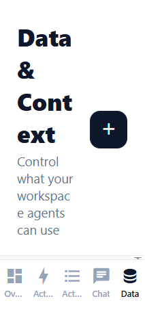
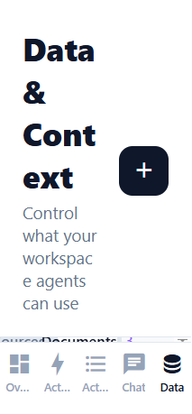

# Data Sources and Documents Workflow

## Assigned Developer

Omar Almekhlafy - Mobile App Intern

## Description

Build a complete Data section where workspace users can review the knowledge available to AutoPilot agents. Workspace Admins can manage demo data-source connections and syncs. Team Members can inspect sources and documents without changing them.

## Completed Work

- Added Sources and Documents views with live inventory counts.
- Added search, clear-search, no-results, and processing states.
- Added source details with status, last sync, and available-record information.
- Added Admin controls to connect, sync, and disconnect demo sources.
- Added a source connection sheet for Google Drive, HubSpot, and PostgreSQL.
- Added Team Member read-only messaging and removed all management controls.
- Enforced `manageData` permission checks inside shared state mutation APIs.
- Used the existing AutoPilot colors, typography, spacing, and component patterns.
- Kept demo connections and changes in memory without claiming real OAuth or backend persistence.

## Acceptance Criteria

- [x] Users can switch between Sources and Documents.
- [x] Users can search the selected inventory and clear the search.
- [x] Users see a helpful empty state when no records match.
- [x] Source rows show type, available records, sync state, and last sync.
- [x] Documents show file type, size, source, date, and processing state.
- [x] Workspace Admins can connect, sync, and disconnect demo sources.
- [x] Team Members can inspect sources and documents but cannot change them.
- [x] Permissions are enforced at the context boundary, not only hidden in the UI.
- [x] The screen has no horizontal overflow at mobile or desktop widths.
- [x] The workflow follows the existing AutoPilot design system.

## Validation

- TypeScript: `npx tsc --noEmit` passed.
- Expo Doctor: 20/20 checks passed.
- Editor diagnostics: no errors in the Data screen or workspace context.
- Admin connect, sync, source-detail, and document-search workflows passed.
- Team Member read-only visibility and source-detail restrictions passed.
- Responsive checks passed at 390 x 844 and 1280 x 800.
- Git whitespace and scope checks passed.

## Implementation

- Updated `app/(tabs)/data.tsx`.
- Updated `src/context/WorkspaceContext.tsx`.
- Published in commit `0a54117` - `feat: add role-aware data workflows`.
- Data changes are demo-only and reset after a full application reload.

## Screenshots

### Workspace Admin - Sources

### Workspace Admin - Documents

### Team Member - Read-Only Access

